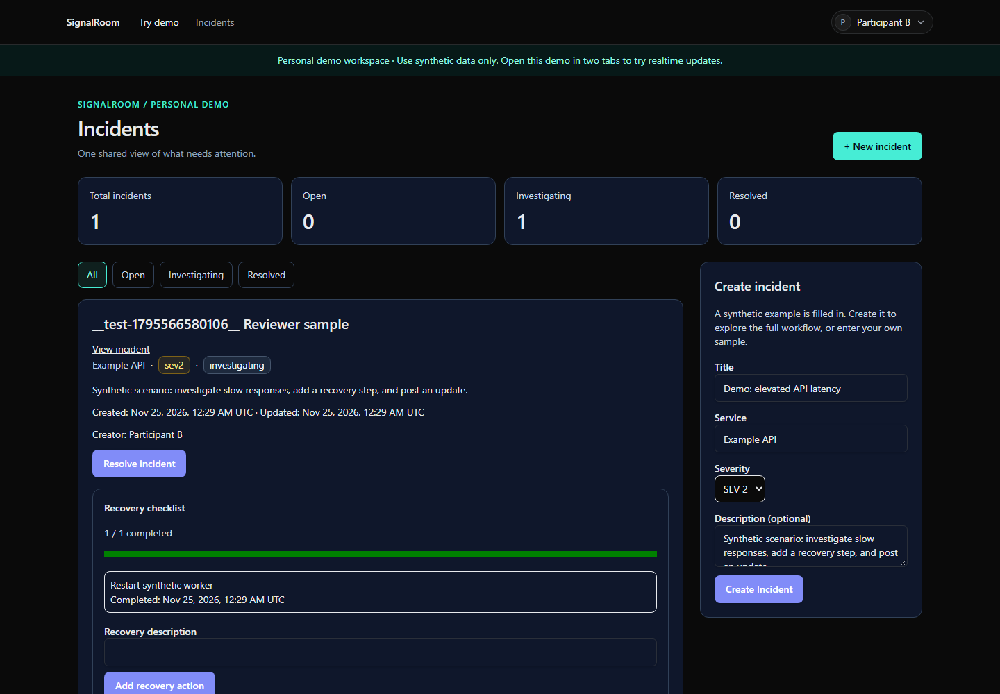
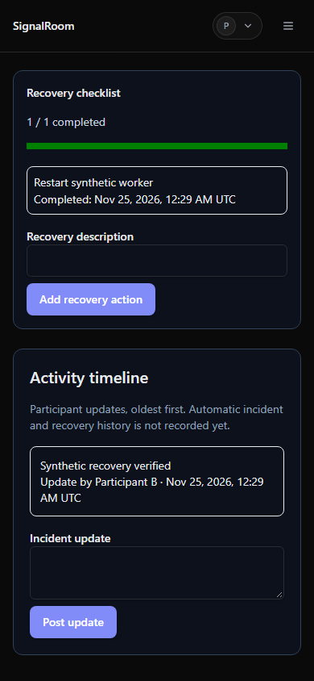

# SignalRoom

**Incident response, without the chaos.** A small incident coordination workspace for tracking an investigation, recovery checklist, and persistent team updates.

**[Open the live app](https://signalroom-singh107.app.space) | [Try the reviewer demo](https://signalroom-singh107.app.space/demo)**

## Evaluate in five minutes

1. Open **Try the demo** and sign in with Google or GitHub. No shared password or manual workspace invitation is required by the application.
2. Submit the prefilled synthetic incident, or enter your own sample. Nothing is created until you click **Create Incident**.
3. Try the dashboard status filters, then **View incident**.
4. Choose **Start investigating**, **Resolve incident**, then **Reopen investigation**.
5. Add and complete a recovery action. Post a participant update and refresh to check persistence.
6. Open the same incident in two tabs/sessions signed in as the **same identity**. Post an update in one and observe the other without refreshing.

Each demo identity has a separate persistent workspace. Different identities cannot see each other's demo incidents. Use synthetic data only; there is no demo reset/cleanup UI. The separate `/incidents` workspace is shared only by its explicitly authorized private participants; demo sign-in does not grant private access.

## Features

- Subscription-derived dashboard counts and All/Open/Investigating/Resolved filters.
- Validated incident creation with service, severity, and optional description.
- Server-enforced lifecycle: open -> investigating -> resolved -> investigating.
- Recovery checklists with persisted completion timestamps and progress.
- Chronological participant-authored updates with server creator/time metadata.
- Native realtime subscriptions, responsive dark layouts, readable UTC timestamps, and authorized actor labels.



<details><summary>Mobile recovery and timeline</summary>



</details>

Screenshots were captured during automated production testing on November 24, 2026 (America/Chicago); their timestamps display UTC. They show synthetic test data, not a real incident.

## Architecture and DeepSpace integration

React + TypeScript and scaffold Tailwind/UI components render the app. Generouted supplies file-based routes. A Hono Worker verifies authentication and dispatches server actions. DeepSpace SDK **0.44.2** provides authentication, native RecordRoom persistence backed by Durable Object SQLite, record permissions, realtime subscriptions, timestamp triggers, and CLI deployment to Cloudflare.

`incidents` is the parent collection. `recoveryActions` and `incidentActivity` reference an incident ID; actions verify the parent exists. The record envelope supplies creator and creation/update timestamps. UI subscriptions render confirmed persisted records; there is no second database or optimistic copy of incident state.

Key code: [actions](src/actions/index.ts), [schemas](src/schemas.ts), [workspace access](src/lib/workspace-access.ts), [action routes](src/server/action-routes.ts), [incident pages](src/pages/(app)/(protected)/incidents), and [learning notes](docs/LEARNING_NOTES.md).

## Security

Server actions validate strict Zod inputs, authorize the caller, and select collaborator grants themselves. Clients cannot supply creator identity, timestamps, or room ownership. Native incident/checklist/activity create/update/delete permissions are denied for every role; privileged action tools therefore require explicit server authorization.

Private records live in the original app scope. A frozen membership baseline fails closed if the private allowlist changes; changing membership requires a deliberate stored collaborator/creator-grant migration.

Demo records live in `demo:<appId>:<verifiedUserId>`. The Worker constructs the action room from verified authentication, and native WebSocket routing checks the exact room against that identity. Client query filters and the frontend workspace context are not authorization boundaries. The demo reuses the private workflow validation without granting access to private data.

Credentials, local sessions, `.dev.vars`, build output, and local databases are ignored. Public app/user IDs are identifiers, not credentials.

## Local development

Verified environment: Windows PowerShell, Node 24.20.0, npm 11.19.0. See `package.json` for supported Node/npm ranges.

```powershell
git clone https://github.com/Singh107/signalroom.git
cd signalroom
npm.cmd ci
npx.cmd deepspace auth login
npx.cmd deepspace dev start
```

Complete browser OAuth yourself and use the URL printed by the CLI. CLI login and application browser login are separate. This checkout identifies the existing registered app: CLI access to its configuration/secrets requires owner authorization. Unaffiliated reviewers should use the hosted demo. Do not deploy this checkout as your own app or casually change its app ID/private baseline.

The runtime and verification commands were exercised during development; the fresh-clone recipe above has not been independently retested on a new machine.

## Testing and evidence

```powershell
npm.cmd run type-check
npm.cmd run lint
npm.cmd run build
npx.cmd deepspace test run all --port 5180
```

Authenticated specs use the official SDK fixture and locally managed **Participant A** and **Participant B** test accounts. They require appropriate local account provisioning; no credentials are included. Their identities have distinct private-access roles, so arbitrary replacement accounts are not drop-in fixtures. Follow [DeepSpace testing documentation](https://docs.deep.space/guides/testing); never publish fixture passwords or weaken the private baseline to make a test pass.

Latest full local suite, November 24, 2026, Task 8: **114 unit + 40 browser/API = 154 passed, 0 failed, 0 skipped**. TypeScript, lint, and production build exited 0.

Task 9 ran a focused subset against the **actual deployed application**: **6 passed, 0 failed, 0 skipped**. It covered public entry, demo workflows, mobile overflow, same-identity multi-session activity, persistence, two-identity isolation and authorization failures. This opt-in command creates synthetic production demo records:

```powershell
npx.cmd playwright test --config tests/playwright.production.config.ts
```

These production tests used supported email/password test identities, not Google/GitHub OAuth. The project owner separately reported completing the Task 8 production acceptance checklist successfully, including the sign-in flow. This is manual user-reported evidence, not automated OAuth coverage. Collaboration between two distinct private participants remains unverified. See [production acceptance](docs/PRODUCTION_ACCEPTANCE.md). No runtime change was needed in Task 9, so the full local suite/build was not repeated and the app was not redeployed.

## Tradeoffs and limitations

- The timeline stores participant-written updates. It is **not a complete automatic audit log**; creation, status changes, reopening and recovery completion do not create automatic events.
- Status changes use separate read/validate/write calls. No supported atomic conditional update was found in the installed API; competing transitions can race. Network retries can duplicate created records/updates.
- Demo rooms are isolated per identity, with no cross-user invitations, quotas, cleanup UI, or pagination. The private shared workspace is a separate access model.
- No assignees, external monitoring, Slack/PagerDuty, analytics, or production incident ingestion.
- No deletion workflow exists; future parent deletion needs an explicit child-record consistency policy.

GitHub is the permanent source authority. Release 1 was deployed from verified clean checkout `188d223`; documentation/test-only changes afterward do not require redeployment. **Never run `deepspace push` for this app.**

## Development process

Codex assisted with implementation, research, tests, debugging, deployment, and documentation. The project owner helped define the idea, requirements, MVP scope and roadmap; reviewed implementation reports and important code excerpts; discussed architecture/tradeoffs; directed priorities; and approved access, persistence, realtime and deployment decisions. The owner reports personally completing the production acceptance checklist and reviewing end-user functionality, navigation and usability. ChatGPT assisted with planning, technical review and explanations. Automated test execution is attributed to Codex; no claim is made that the owner independently wrote every line or performed a comprehensive security audit. See [build log](docs/BUILD_LOG.md), [learning notes](docs/LEARNING_NOTES.md), and [submission draft](docs/SUBMISSION.md).
